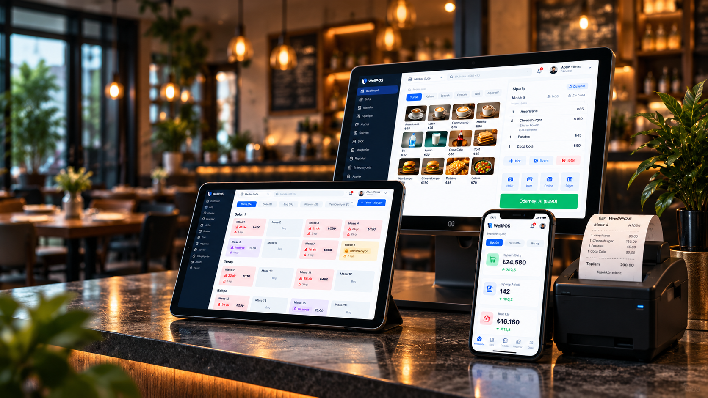
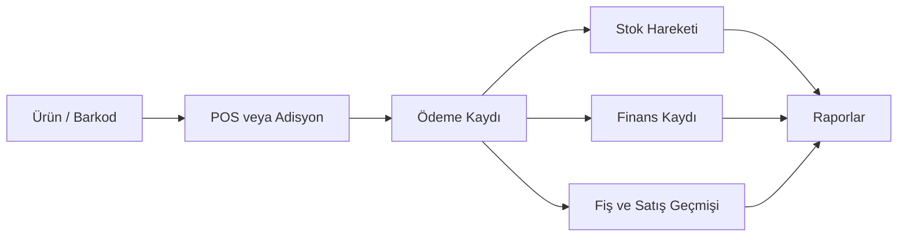
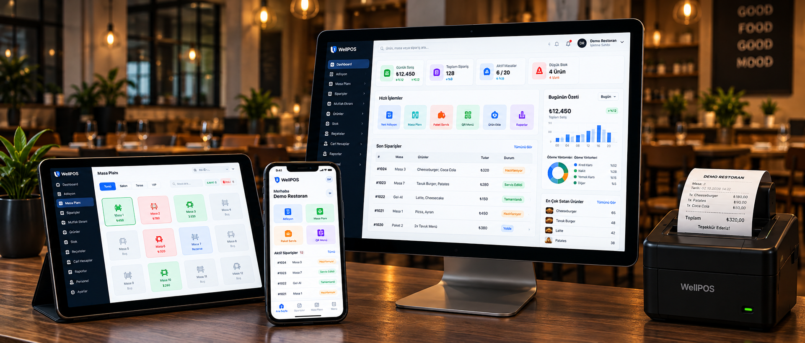

<div align="center">


# Well ERP · WellPOS

### Satıştan stoğa, mutfaktan finansa — işletmenizin ortak çalışma alanı.

Restoran, kafe ve perakende işletmeleri için geliştirilen, çok şubeli operasyonları bir araya getiren web tabanlı işletme yönetim platformu.


**[Canlı uygulama](https://wellpos.vercel.app) · [Özellikler](#özellikler) · [Kurulum](#yerel-kurulum) · [Yol haritası](#yol-haritası)**

</div>



> Cihaz görselleri temsili ürün tanıtım görselleridir; birebir uygulama ekran görüntüsü veya fiziksel cihaz entegrasyonu garantisi değildir. Mevcut kapsam aşağıda belirtilmiştir.

## Neden Well ERP?

Kasadaki bir satış yalnızca bir tutar değildir: stok miktarını, tahsilatı, raporları ve bazen mutfaktaki işi de etkiler. Well ERP, bu bağlantıları ortak bir işletme ve şube bağlamında yönetmek için geliştiriliyor.

Ürünün kullanıcıya görünen markası **WellPOS**, bu kaynak deponun adı **well-erp**. Proje adı geçmişte MERN olarak başlamış olsa da mevcut uygulama **Next.js + PostgreSQL + Prisma** mimarisini kullanır.

## Özellikler

| Modül | Bugün neler yapılabilir? |
| --- | --- |
| **POS ve satış** | Ürün/SKU/barkod arama, sepet, indirim, nakit/kart ödeme yöntemi kaydı, fiş ve tam iade |
| **Masalar ve adisyonlar** | Masa bazında adisyon, ürün ekleme, ödeme ve boş adisyon iptali |
| **Mutfak ekranı** | Hazırlık, hazır ve servis durumları; ödenmiş fakat hazırlığı devam eden işlerin takibi |
| **Ürün ve stok** | Kategoriler, ürün görselleri, birimler, şube stoku, giriş/çıkış, transfer ve kritik stok eşikleri |
| **Reçete ve üretim** | Hammadde/reçete tanımları, üretim ve buna bağlı stok hareketleri |
| **Finans** | Nakit/kart/banka hesap kayıtları, kasa hareketleri, hesaplar arası transfer, tahsilat ve ödemeler |
| **Ticari kayıtlar** | Müşteriler, tedarikçiler, cari hesaplar, giderler ve uygulama içi faturalar |
| **QR menü** | Şube/masa bağlantıları, müşteri menüsü, garson çağırma ve hesap isteme talepleri |
| **Raporlar** | Tarih/şube filtreleriyle satış, finans, stok ve diğer operasyon görünümleri; CSV dışa aktarımları |
| **Yönetim** | İşletmeler, şubeler, personel profilleri, rol bazlı erişim ve görünüm tercihleri |
| **AI asistanı** | Yetkili şubenin satış ve kritik stok özetini Türkçe yorumlama |

### Bir satışın devamında ne olur?



Para hesaplamaları PostgreSQL numeric ve Prisma Decimal ile yapılır. Kritik işlemlerde transaction ve tekrar gönderilen isteklere karşı kalıcı istek anahtarları bulunur. Tam iadelerde satış, kasa ve stok ilişkileri birlikte ele alınır.

## İşletmenize sorun

Dashboard’daki **“İşletmene sor”** kartı, seçili şubeye ait sunucuda hesaplanan verilerle çalışır:

- “Bugünkü işletme özetini çıkar.”
- “Bugünkü satışlar düne göre nasıl?”
- “Hangi ürünlerin stoğu kritik?”

Gemini varsayılan sağlayıcıdır; OpenAI alternatifi de desteklenir. API anahtarları sunucuda kalır. Asistan satış, stok veya ayar kaydı değiştirmez; her soru bağımsızdır ve sohbet geçmişi tutulmaz.

**Veri kapsamı:** Bugünkü satış toplamı/sayısı/ortalaması, düne göre değişimler, son 30 günün günlük satışları ve izin verilen kritik stok özeti. Kasa bakiyesi, kâr, ürün satış sıralaması ve stok tükenme tarihi bu asistana verilmez. AI metinleri hata içerebilir; rakamlar raporlardan doğrulanmalıdır.

Gemini’nin ücretsiz katmanı kotalıdır ve gönderilen içerik ürün geliştirmede kullanılabilir. [Güncel sağlayıcı koşulları](https://ai.google.dev/gemini-api/docs/pricing).



*Mevcut ürün responsive bir web uygulamasıdır. Ayrı native mobil uygulama henüz geliştirilmemiştir.*

## Erişim ve veri kapsamı

- **İşletme ve şube bağlamı:** Veri erişimi aktif üyelik, personel profili ve şube izinleriyle sınırlandırılır.
- **Rol bazlı yetkiler:** Yönetim, satış, mutfak ve finans akışları ortak yetki matrisi üzerinden kontrol edilir.
- **Kimlik doğrulama:** Auth.js ile Google OAuth ve yerel e-posta/parola girişi.
- **İşlem izleri:** Kritik mutasyonlarda audit kayıtları; ürün geçmişini koruyan arşivleme.
- **Sunucu kontrolleri:** İstek kaynağı, gövde boyutu ve girdi doğrulamaları; temel istek sınırlaması.

Bu kontroller bağımsız güvenlik denetimi veya mevzuat uyumluluğu sertifikası değildir. Süreç belleğindeki istek limitleri çok instance ortamında ortak bir depoya taşınmalıdır.

## Teknik yapı

| Katman | Teknoloji |
| --- | --- |
| Web ve API | Next.js 16, App Router, React 19, TypeScript |
| Arayüz | Tailwind CSS 4, Lucide, Recharts |
| Veri | PostgreSQL, Prisma ORM 7, PostgreSQL driver adapter |
| Giriş | Auth.js / NextAuth v5 |
| AI | Gemini API; isteğe bağlı OpenAI Responses API |
| Görseller | UploadThing |
| Belgeler | pdf-lib, QRCode, yerel fontlar |
| Yayın | Vercel; mevcut canlı ortamda Neon PostgreSQL |

```text
src/
  app/             Web sayfaları ve API route’ları
  components/      POS, mutfak, stok, finans ve yönetim arayüzleri
  lib/             Yetkilendirme, iş kuralları ve veri servisleri
prisma/            Şema ve migration geçmişi
public/            Marka görselleri, favicon ve fontlar
tests/             Çevrimdışı ve entegrasyon testleri
scripts/           Doğrulama ve operasyon araçları
docs/              Modül tasarımları ve teknik açıklamalar
```

## Yerel kurulum

**Gereksinimler:** Node.js 24.x, npm ve ayrı bir PostgreSQL geliştirme veritabanı.

```bash
git clone https://github.com/AdemHos/well-erp.git
cd well-erp
npm ci
```

`.env.example` dosyasını `.env` adıyla kopyalayıp `DATABASE_URL`, `AUTH_SECRET` ve kullanacağınız servislerin anahtarlarını doldurun. Örnek dosya gerçek anahtar içermez.

```bash
# Çıktıyı AUTH_SECRET olarak kaydedin.
node -e "console.log(require('crypto').randomBytes(32).toString('base64'))"

npm run prisma:generate

# Yalnızca bu proje için hazırladığınız boş geliştirme veritabanına uygulayın.
npx prisma migrate deploy --config prisma7.config.ts

npm run dev
```

[localhost:3000](http://localhost:3000) üzerinden ilk hesabı oluşturup işletme/şube kurulumunu tamamlayın. Google girişi için OAuth istemcisine `http://localhost:3000/api/auth/callback/google` callback’ini ekleyin. AI ve görsel yükleme, ilgili servislerin geçerli anahtarlarını gerektirir.

Mevcut iş veritabanına bağlanmadan önce migration geçmişi, yedek ve geçiş planını değerlendirin.

## Doğrulama

```bash
npm run typecheck
npm run test:offline
npm run lint
npm run build
```

Son doğrulamada **134 çevrimdışı test** geçti; TypeScript ve Vercel production build başarılı tamamlandı. Bu paket gerçek PostgreSQL kilitlerini/constraint’lerini, canlı OAuth’u veya fiziksel cihazları tek başına doğrulamaz. PostgreSQL entegrasyon testleri yalnızca izole test veritabanında çalıştırılmalıdır.

## Yayın

`vercel.json`, `npm ci` ve `npm run build` komutlarını tanımlar. Build Prisma istemcisini üretir; migration’lar ayrı bir deployment adımıdır. Gerekli ortam değişkenlerini sunucuda tanımlayın ve Google OAuth callback’ini gerçek yayın adresiyle eşleştirin. [Deployment rehberi](docs/deployment.md).

## Mevcut sınırlar

Proje aktif geliştirme aşamasındadır. Fatura modülü uygulama içi belge/PDF üretir; resmi e-Fatura/e-Arşiv entegrasyonu değildir. Kart ödeme yöntemi kaydı, banka POS terminalinden gerçek tahsilat yapıldığı anlamına gelmez. Fiş yazdırma tarayıcı akışıdır; her fiziksel yazıcıyla doğrulanmış destek sunulmaz.

Kısmi iade, parçalı ödeme, adisyon taşıma/bölme/birleştirme, harici yemek platformları ve webhook bağlantıları mevcut kapsamın dışındadır. Kârlılık raporlarının maliyet verisi sınırlamaları [rapor dokümanında](docs/reports.md) açıklanır.

## Yol haritası

- [x] POS, stok, restoran ve finans modülleri
- [x] Çok şubeli erişim, personel profilleri ve raporlar
- [x] Şube verileriyle çalışan AI asistanı
- [x] Vercel web yayını
- [ ] `mobile/` altında React Native + Expo uygulaması
- [ ] Fatura fotoğrafından ürün/miktar/fiyat çıkarma
- [ ] Kullanıcı onayıyla ürün eşleştirme ve stok giriş taslağı
- [ ] Satış hızı ve tedarik verileriyle sipariş önerileri

## Daha fazla bilgi

[AI asistanı](docs/ai-assistant.md) · [Yetkilendirme](docs/rbac.md) · [POS finansı](docs/pos-finance.md) · [Raporlar](docs/reports.md) · [Ayarlar](docs/settings.md) · [Entegrasyonlar](docs/integrations.md)

## Lisans ve marka

Bu depo şu anda açık kaynak lisansı içermez. Kaynak kodun herkese açık olması, yeniden kullanım veya dağıtım için otomatik lisans vermez. WellPOS marka görselleri projeye aittir; üçüncü taraf bağımlılıkların ve `public/fonts/` içindeki fontların kendi lisansları geçerlidir.

<div align="center">

**Well ERP / WellPOS · Developed by WellSoft**

</div>
